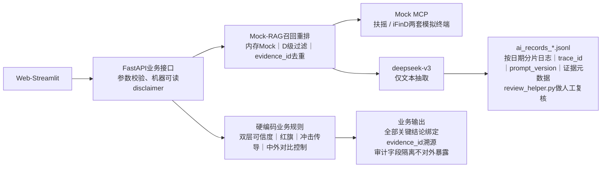

# energy-storage-ai-research
A AI research product for electrochemical energy storage industry chain, support company credibility rating, China-overseas benchmark comparison, external shock transmission simulation, all conclusions traceable with evidence_id. Demo with mock MCP data, not investment advice.

⚠️全部为Mock模拟数据，**不构成任何投资建议**

## 🎯项目简介
投研分析师辅助AI产品：
1. 电化学储能产业链分层、标的归属识别，区分真实业务标的与蹭概念炒作标的；
2. 中外储能企业对标，输出可比/不可比维度；
3. 外部事件推演冲击传导链路：事件 → 产业链环节 → 公司业务 → 财务指标；
4. **全部关键结论evidence_id证据可溯源，LLM仅做文本抽取，业务规则全部硬编码规避幻觉风险。**
   
## 📁仓库目录
```
energy-storage-ai-research/
├── README.md                     # ✅【仓库根目录】总览、快速上手、跳转文档，面试官打开仓库直接展示
├── docs/                         # 📂笔试完整交付文档集（详细设计、测试、AI记录）
│   ├── PROJECT_SPEC.md           # 任务一完整项目设计大纲
│   ├── 测试用例说明.md            # 测试用例集合：主链路/异常/合规边界
│   └── AI_使用与验证记录.md       # AI调用审计、人工复核记录模板
├── src/                          # 📂业务源码目录
│   ├── main.py                   # FastAPI 后端服务入口
│   ├── schemas.py                # Pydantic 全部数据Schema、枚举定义
│   ├── mcp_mock.py               # Mock实现扶摇MCP / iFinD MCP
│   ├── llm_wrapper.py            # LLM调用封装、日志分片落盘逻辑
│   ├── web.py                    # Streamlit Web交互前端
│   └── review_helper.py          # ai_records 人工复核辅助脚本
├── runtime_output/               # 📂程序运行自动生成输出目录
│   └── ai_records/               # 按日期分片审计日志（仅本地运行生成，git忽略*.jsonl，只提交空目录）
├── .env.example                  # 环境变量模板
├── .gitignore                    # git忽略配置
└── requirements.txt              # Python依赖清单

```
## 📁仓库文档导航
> 详细设计规格、测试用例、AI校验记录全部在 `docs/` 文件夹
- [项目完整设计大纲（任务一）](./docs/PROJECT_SPEC.md)
- [测试用例说明（主链路 / 异常 / 合规边界）](./docs/测试用例说明.md)
- [AI 使用与验证记录](./docs/AI_使用与验证记录.md)

## 🎯目标用户
投研分析师，完成：
1. 电化学储能产业链分层、标的归属识别；区分真实储能业务标的与蹭概念炒作标的
2. 中外储能企业对标，自动区分可比/不可比维度
3. 外部事件（大宗商品、政策）推演：冲击→产业链环节→公司业务→财务指标传导路径
4. 全链路证据溯源、AI调用审计，**关键结论绑定evidence_id可追溯**

## 🧠核心设计
1. **双层可信度体系**
- 第一层：证据信源分级A/B/C/D；区分`fact(事实)/forecast(预测)/opinion(观点)`；遵循情报原则：**先评估来源，再评估信息；多源交叉印证；D级传闻仅作线索**
- 第二层：标的业务可信度L4‑L1（L4有储能营收 → L3试点 → L2框架协议 → L1仅概念表态无实质业务）
2. 红旗预警R01/R02/R03：检测规则+处置策略；识别单信源、同源搬运、高可信证据冲突
3. Mock‑RAG三级链路：召回‑重排‑引用选择；⚠️内存Mock模拟，**无真实向量库，仅演示业务链路**
4. AI角色强约束：deepseek‑v3 **仅做文本抽取**；产业链归属、可信度打分、红旗判定、冲击传导全部硬编码，LLM不做业务决策，规避金融幻觉
5. 全链路可追溯：产业链归属、中外对比结论全部绑定`evidence_id`；审计/业务两套Schema隔离；原始LLM输出、人工复核仅写入后台`ai_records_*.jsonl`，业务接口不对外暴露审计敏感字段
6. Mock实现两套MCP：**扶摇MCP、iFinD MCP**，模拟股票财务、公告、研报、业务、海外公开资料。


## 📦数据源说明

> 
> 本 Demo 为笔试模拟，**未调用真实扶摇、iFinD 付费接口，全部内存 Mock**

1. 模拟数据源类型：上市公司年报 / 公告、券商研报、行业新闻、股吧舆情传闻、海外企业年报
2. 样本集合：
   - 真实业务头部标的：阳光电源、派能科技
   - 试点 / 框架标的：科士达、华自科技
   - 蹭概念标的（2 家）：山东章鼓、国机通用
   - 海外对标标的：Fluence
3. 内置测试样本：矛盾证据、预测类文本、观点类文本、高可信信源互相冲突样本；MCP 支持模拟超时、空返回脏输入场景。

## ⚠️已知边界与未做事项

1. Mock‑RAG：内存模拟结构，**没有部署真实向量数据库、没有文档切片、无向量检索**；未实现时间衰减重排。
2. 红旗预警仅实现 R01/R02/R03 三条；剩余情报 8 条红旗规则未实现；R03 冲突检测仅关键词占位实现，非 NLP 语义事实对齐。
3. `fact/forecast/opinion`证据类型仅元数据标记，**本版本没有纳入可信度加权运算**。
4. 中外对比固定输出预定义枚举维度，未实现基于业务特征动态过滤无效对比维度。
5. 同源复制识别为简易词集合交集，无法识别同义词改写、语序改写的同源文本，存在漏判、误判风险。
6. 不做股价预测、估值、买卖投资建议；不爬取互联网实时舆情，仅消费 MCP 输入数据。
7. 无登录权限系统；无 pytest 自动化单元测试；人工复核禁止手改 jsonl，使用`review_helper.py`脚本。
8. 证据增量流式更新能力未实现；不支持用户自定义新增冲击事件。

## 🛠部署步骤

1. 安装依赖

```
pip install fastapi uvicorn pydantic openai python‑dotenv streamlit
```

2. 复制`.env.example`为`.env`，填入`DEEPSEEK_API_KEY`
3. 启动后端服务：`python main.py`
4. 启动 Web 前端：`streamlit run web.py`
5. 人工复核审计日志：`python review_helper.py`

## 🎬演示视频脚本（60‑180s，建议 145s）

1. 0‑15s：开场白，项目背景，说明全部 Mock 模拟，不构成投资建议；介绍双层可信度、证据溯源核心设计。
2. 15‑50s：演示【产业链查询】；展示 L4 真实业务标的、L1 山东章鼓 / 国机通用蹭概念标的；展示信源等级、证据类型；**展示产业链归属绑定 evidence_id 溯源 ID**；演示 D 级股吧传闻不会拉高业务可信度。
3. 50‑88s：演示【中外公司对比】阳光电源 vs Fluence；输出可比 / 不可比维度，结论绑定 evidence_id。
4. 88‑115s：演示【外部冲击传导推演】，选择事件 “美国 IRA 储能补贴收紧”；展示事件信源等级、传导链路、置信度、生效前置条件。
5. 115‑132s：演示红旗预警触发（R01 单源、R03 高可信证据冲突自动降级）。
6. 132‑145s：打开仓库说明`ai_records_*.jsonl`审计日志；展示`review_helper.py`人工复核脚本；口述已知边界，风险显性化收尾。

## 📋交付物清单

1. main.py FastAPI 后端入口
2. schemas.py 全部 Pydantic Schema、枚举定义
3. mcp_mock.py 扶摇 MCP /iFinD MCP 模拟实现
4. llm_wrapper.py LLM 封装，强制日志落盘、日志分片
5. web.py Streamlit Web 前端（可直接操作 Web 产品）
6. review_helper.py 审计日志人工复核辅助脚本
7. PROJECT_SPEC.md 任务一完整项目大纲
8. AI_使用与验证记录.md AI 调用校验记录
9. 测试用例说明.md 主链路、接口异常、合规边界测试说明
10. .env.example、.gitignore
11. ai_records/ 运行后自动生成 AI 审计日志

## 🛠快速启动
```bash
# 1.安装全部依赖
pip install -r requirements.txt

# 2.配置环境变量
cp .env.example .env
# 编辑.env填入 DEEPSEEK_API_KEY

# 3.启动FastAPI后端
python src/main.py

# 4.启动Streamlit Web前端
streamlit run src/web.py

# 5.审计日志人工复核工具
python src/review_helper.py
```
## 合规声明

> 
> 本产品为笔试 Demo，全部为 Mock 模拟数据，**不构成任何投资建议**。

